# Qur’an Ayah of the Day

A daily Qur’an verse for your GitHub profile, with animated Arabic calligraphy and an English translation that types in alongside it. Click the banner to read the verse on Quran.com.

<!-- ayah-of-the-day:start -->
<a href="https://quran.com/96/1"><picture><source media="(prefers-color-scheme: dark)" srcset="assets/ayah-dark.svg"></picture></a>

<sub><a href="https://tanzil.net/">Tanzil Project</a> · <a href="https://tanzil.net/trans/">Saheeh International</a></sub>
<!-- ayah-of-the-day:end -->

## Add it to your profile

1. Copy the [example workflow](examples/profile-workflow.yml) into your public profile repo (`your-username/your-username`) as `.github/workflows/daily-ayah.yml`.
2. Paste these two lines into your profile `README.md` where you want the banner:

   ```html
   <!-- ayah-of-the-day:start -->
   <!-- ayah-of-the-day:end -->
   ```

3. On the default branch, go to **Actions → Update Qur’an ayah card → Run workflow**. Leave **verse** blank for the daily rotation, or enter `94:5` to test it. After the run succeeds, open your profile and click the banner to check its link. If you tested a verse, run it again with the field blank to return to today’s ayah.

No API key or separate server needed.

## Customize it

The banner rotates through [39 ayahs](src/verses.json) by default. You can also pick any verse by reference, change the colors, switch the translation language, or turn off the animation. See [the available settings](action.yml).

The code is [MIT licensed](LICENSE). Qur’an text and translations come from [Tanzil](https://tanzil.net/) and have [separate terms](https://tanzil.net/trans/).
